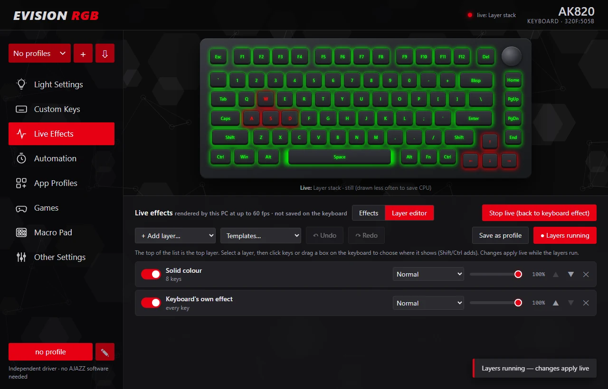
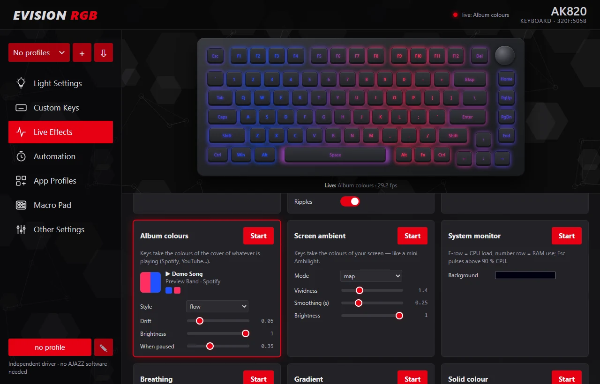
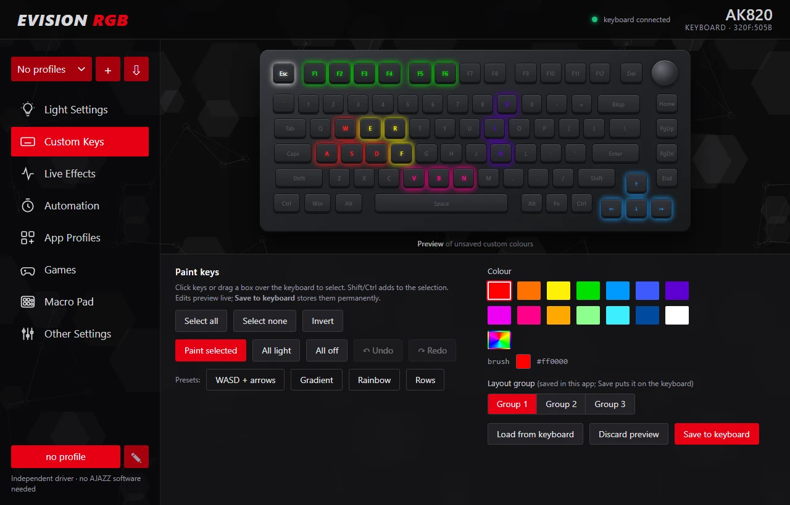
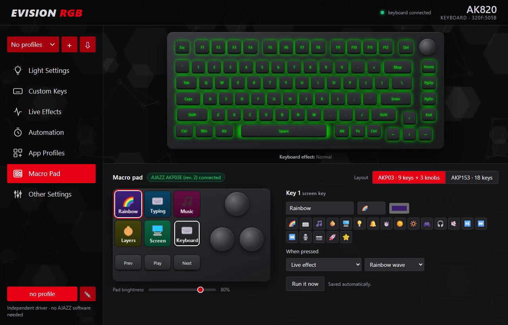
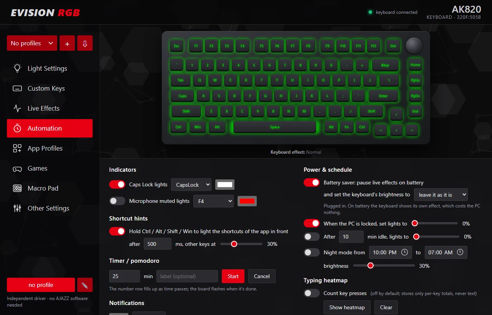
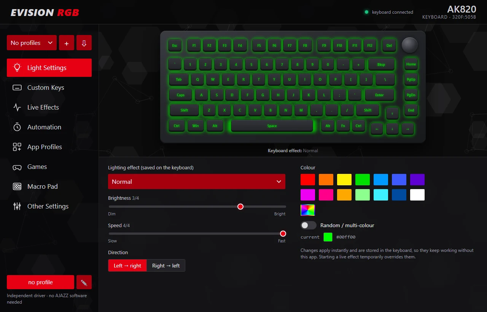
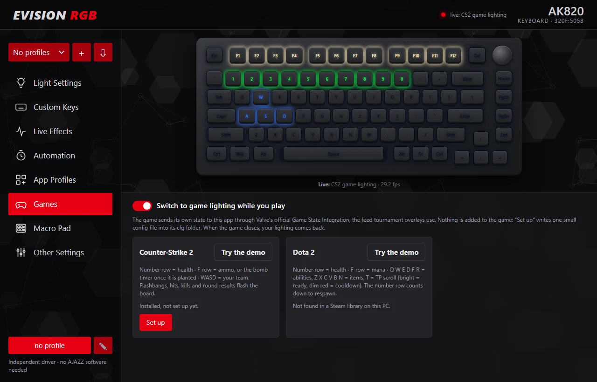

# evision-rgb

Open-source lighting control for **EVision-based keyboards** (USB vendor `0x320F`), starting with the
**AJAZZ AK820** wired RGB, and for **AJAZZ AKP macro pads**. No vendor software needed: per-key colours, the keyboard's
built-in effects, layered live effects rendered by your PC (~60 fps), music sync, shareable profiles, macro-pad keys
and knobs, a desktop app, an HTTP API and an MCP server for AI agents.

> Not affiliated with AJAZZ or EVision. Product names are used only to describe compatibility.

## Supported devices
| Device | USB id | Status |
|---|---|---|
| AJAZZ AK820 (wired RGB, fw V0103) | `320F:505B` | **verified**: everything below tested on hardware |
| Marvo KG980A, Koorui MK104, Skillkorp K5, Mars Gaming MK5 | `320F:505B` | same protocol reported; layout differs, untested |
| AJAZZ AK820 **Pro** | `0C45:8009` | different chip and protocol, not supported |
| AJAZZ **AKP03** family macro pads (6 screen keys, 3 buttons, 3 knobs), Mirabox N3 | `0300:1001-1003`, `0300:3002-3003`, `6602/6603` | from published protocol, simulator-tested; [docs/MACROPADS.md](docs/MACROPADS.md) |
| AJAZZ **AKP153** family macro pads (15 + 3 screen keys), Mirabox HSV293S | `5548:6674`, `0300:1010/1020/3010/3011`, `5548:6670` | from published protocol, simulator-tested |

## Features
- **Built-in effects**: all 18 firmware effects with brightness, speed, direction and colour, stored on the keyboard.
  The on-screen preview runs the keyboard's own firmware code in an emulator, so it matches the real keyboard exactly
  (see [docs/FIRMWARE.md](docs/FIRMWARE.md)).
- **Per-key colours**: paint keys in the app with undo/redo and save them to the keyboard. They keep working with the app closed.
- **Live effects** (~60 fps, rendered by the PC): rainbow, breathing, gradient, typing ripples, **music visualiser**
  (bars, VU meter, beat flash, bass ripples, pulse), **screen ambient**, **system monitor** (CPU/RAM bars), typing heatmap,
  and classics after FastLED's examples: **fire**, **ocean** waves, **twinkling** stars and **digital rain**.
- **Album colours**: the keys take the colours of the cover of whatever is playing (Spotify, YouTube in a browser, any
  player in Windows' media controls), drifting across the board, painted as the cover itself, or as one colour.
  No account or API key. A macro pad's play/pause key shows the cover and whether it is playing.
- **Game lighting** (CS2, Dota 2): health on the number row, ammo or the bomb timer on the F-row, team colour on WASD,
  flashbangs and hits; Dota abilities and items on their keys with cooldowns, and the respawn countdown. It uses
  Valve's official Game State Integration (the game sends its own state; nothing touches the game), switches on while
  you play and has a demo. See [docs/GAMES.md](docs/GAMES.md).
- **Layer editor**: stack effects like layers in an image editor. Each layer has its own keys, blend mode (normal,
  screen, add, brightest, multiply) and opacity. The bottom layer can be the keyboard's own built-in effect, for example
  the firmware's Rain with red WASD and typing ripples on top. Includes templates and undo/redo.
- **Profiles you can share**: save the hardware effect, custom colours and layer stack as a profile. Apply it in one
  step from the app, the tray, the API or an AI agent. Export it as a file or a short `evrgb1:…` share code, and
  import other people's. Imports are validated and change nothing until you apply them.
- **Automation**: Caps Lock / mic-mute indicator keys, notification flashes, a number-row timer, dimming when idle or
  locked, a night schedule, and shortcut hints (hold Ctrl and the shortcuts of the app in front light up).
- **Battery saver**: when a laptop runs on battery, live effects, layer stacks and app profiles pause and the keyboard
  shows its own built-in effect, which costs the PC nothing. Plugging in brings back exactly what was running.
  Indicators, notifications and the timer keep working. It can also dim the keyboard on battery (its lights run
  on the laptop's USB power) and bring the brightness back when you plug in.
- **Light on CPU**: a picture that doesn't change isn't redrawn 60 times a second or resent to the keyboard (only a
  keep-alive is), and the app window's preview only receives frames that changed.
- **App profiles**: lighting follows the program in front (Spotify → music, VS Code → typing ripples, a game → a layer stack).
- **Macro pads** (AJAZZ AKP03 / AKP153 "stream docks"): draws icons on the pad's screen keys and runs an action per
  key or knob turn. Actions include lighting profiles, effects, the layer stack, keyboard brightness, media keys,
  hotkeys, a timer and launching programs. The key whose effect is running gets a frame. Set it up in the app before
  the pad arrives.
- **OpenRGB programs**: the app can answer as an OpenRGB SDK server, so Artemis, SignalRGB (with its OpenRGB bridge),
  Home Assistant and OpenRGB scripts light the keyboard through it, with indicators on top. See
  [docs/OPENRGB.md](docs/OPENRGB.md).
- **Desktop app**: AJAZZ-style UI with a live preview of the keyboard, tray icon, start with Windows, conflict detector.
  It reconnects by itself when the keyboard is replugged or the PC wakes up, and starts without the keyboard.
- **For agents and scripts**: a local HTTP JSON API and an **MCP server**, so Claude or another agent can drive the lights.
- **Safe by design**: only commands confirmed from the vendor app are on the keyboard's allow-list. Firmware-update,
  keymap and macro writes are never sent, and everything written is read back and verified. Pads get only the
  documented display and keep-alive commands; boot-logo and config writes are refused. The local API answers only
  programs on this PC, so web pages cannot drive it.
- The app backs up the keyboard's lighting the first time it connects, and can restore it any time.
- **Recent events and diagnostics**: Other Settings lists what happened with times (the keyboard disconnecting,
  battery and mains, what the battery saver did, errors) and copies a diagnostics block for bug reports, with
  secrets hidden.

## Screenshots
| | |
|---|---|
|  |  |
|  |  |
|  |  |
|  | |

<sub>Taken against the keyboard and pad simulators with a pretend song (`node scripts/screenshots.mjs`).</sub>

## Download (Windows)
Get the app from **[Releases](https://github.com/HaritMT25/evision-rgb/releases)**: unzip
`EVision-RGB-<version>-windows-x64.zip` anywhere and run `EVision RGB.exe`. No Python or AJAZZ software needed
(Windows 10 or 11, 64-bit).

Windows shows "Windows protected your PC" because the app is not code-signed: click **More info**, then
**Run anyway**. Each download has a `.sha256` file to check it against (`Get-FileHash <zip>` in PowerShell). Every
release is built by GitHub from this repository's source, and the built app checks itself before it is published.

## Install (from source, Windows)
```powershell
git clone https://github.com/HaritMT25/evision-rgb && cd evision-rgb
python -m venv .venv; .venv\Scripts\activate
pip install -e ".[app,mcp]"    # app = everything the desktop app uses (gui, effects, pads, media, emulation)
evision-rgb          # desktop app
```
Build a standalone exe: `pip install -e ".[app,dev]"` then `sh scripts/build_exe.sh` → `dist\EVision RGB\EVision RGB.exe`
(`"EVision RGB.exe" --selftest report.json` checks a build without touching any device).

**Close other RGB software first** (the AJAZZ app, OpenRGB, Nexus, SignalRGB). They write to the same channel. Nexus runs
OpenRGB in the background, which sends this keyboard the wrong protocol. The app detects these and offers to close them.

## CLI
```powershell
evrgb info
evrgb effect breath -b 3 -s 1 -c 00a0ff            # brightness 0..4 (5 turns the LEDs off on the AK820)
evrgb custom --all 000010 W=ff0000 A=ff0000 S=ff0000 D=ff0000
evrgb live music                                    # also: nowplaying, rainbow, reactive, sysmon, breathing, gradient, solid
evrgb apps profiles\example.json
evrgb serve                                         # HTTP API on 127.0.0.1:8820
```

## Python
```python
from evision_rgb import Keyboard
with Keyboard() as kb:
    kb.set_effect("normal", brightness=3, color="ff0080")       # stored on the keyboard
    kb.set_custom({"W": "ff0000", "Esc": "00ff00"})              # per-key, stored
    with kb.stream() as s:                                       # live, not stored
        s.fill("000010"); s.set("Enter", "ffffff"); s.show()
```

## HTTP API & MCP
`GET /status /info /keys /effects /modes /frame /stream /custom /settings /profiles /profiles/export /events /diagnostics` ·
`POST /effect /custom /run /keys /clear /stop /apps /notify /timer /automation /heatmap /profiles/import /profiles/apply /restore`.
`GET|POST /openrgb {"enabled": true, "port": 6742}` runs the OpenRGB SDK server. Game lighting: the game posts to `POST /game/cs2` / `/game/dota2` (with the token from its config file);
`GET /games` shows what is installed and set up, `POST /games/setup {"game": "cs2"}` / `/games/remove` write or delete
the config file. `GET /nowplaying` says what is playing (title, artist, app, cover colours) and `/nowplaying/cover.png` serves the
cover. `GET /status` includes `battery` (`on_battery`, `saver`, `paused`, `brightness`, `dimmed`); `POST /automation {"battery": {"enabled": false}}`
switches the battery saver off, `{"battery": {"brightness": 1}}` dims the keyboard to 1 of 4 on battery (`null`: leave it). See `evision_rgb/server.py`.

A layer stack is an ordinary live effect:
```json
POST /run {"effect": "layers", "params": {"layers": [
  {"effect": "keyboard"},
  {"effect": "solid", "params": {"color": "ff0000"}, "keys": ["W", "A", "S", "D"]},
  {"effect": "reactive", "params": {"base": "000000"}, "blend": "screen", "opacity": 0.8}]}}
```
Layers are listed bottom first. `keys` sets where a layer shows (every key by default). `blend` is one of
`normal | screen | add | max | multiply`. `"keyboard"` is the effect stored on the keyboard.

MCP (Claude Code): `claude mcp add evision-rgb -- <venv>\Scripts\python.exe -m evision_rgb.mcp_server`
gives the tools `keyboard_status, list_keys, list_effects, set_hardware_effect, set_custom_colors, run_live_effect,
set_live_keys, clear_live_keys, stop_live, notify, start_timer, cancel_timer, list_profiles, apply_profile,
export_profile, import_profile, pad_status, set_pad_key, now_playing, game_lighting, recent_events`.

## Tests
Behaviour specs run against a **firmware simulator** (`tests/fake_device.py`) that models the observed firmware
behaviour, including its quirks. A mutation check proves the suite catches real past bugs.
```powershell
cd tests; python -m unittest                    # behaviour + unit tests, no keyboard needed
python ..\scripts\mutation_check.py              # each known past bug must make the suite fail
python ..\scripts\mutation_check.py battery      # only the mutants whose name contains "battery"
$env:AK820_HW=1; python -m unittest test_hardware   # optional checks on a real keyboard (restores state)
```
The desktop UI can be developed and tested against the simulator too:
```powershell
python scripts\ui_preview_server.py 8899        # the app UI on http://127.0.0.1:8899/ with a simulated keyboard
node scripts\ui_smoke.mjs 8899                   # drives the UI in headless Edge/Chrome; fails on any JS error
```

## How it works
See **[docs/PROTOCOL.md](docs/PROTOCOL.md)** for the full EVision V2 protocol, LED map and firmware quirks.

## Contributing
See **[CONTRIBUTING.md](CONTRIBUTING.md)** (safety rules, specs first, the mutation check). Have another EVision
keyboard? **[docs/ADDING_A_KEYBOARD.md](docs/ADDING_A_KEYBOARD.md)** says what to collect. What changed in each
version: [CHANGELOG.md](CHANGELOG.md).

## License
MIT. See [LICENSE](LICENSE).
